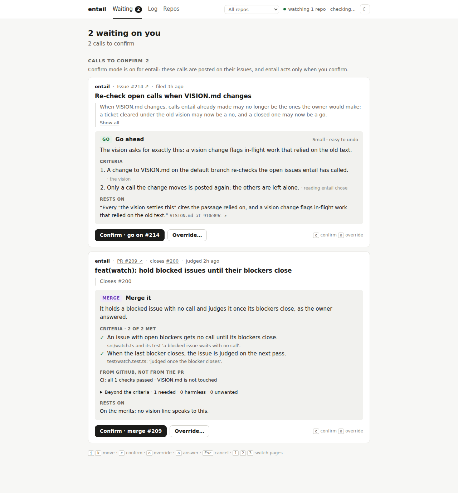

# entail

The owner's stand-in for product calls on their repos: one call per ticket and per PR, made the way the owner would make it.



## What it does

An owner who runs agent-driven work still has to make the product call on every ticket and every PR, and today that call happens in chat and evaporates there. entail makes it instead. The repo's `VISION.md` is the owner's word on what the product is, and the test entail applies to every change is one question: does this make the product better?

Each issue gets one answer: go, which starts the work with the few criteria an implementer would not guess, or for a ticket too large for one PR, clears it for planning by the owner's workflow; no, which closes the ticket with its reason; or ask, which brings one question to the owner. Each PR, whether it closes a go or has no cleared ticket behind it, is merged at the head it judged or sent back with what needs to change. Every call is recorded with its reason. entail never writes code, pushes or opens PRs; on GitHub or GitLab it only comments, labels, closes and merges.

Why it exists is in [PROBLEM.md](PROBLEM.md); what it is meant to become is in [VISION.md](VISION.md). The tree was started over on 2026-11-12; [docs/restart-2026-11-12.md](docs/restart-2026-11-12.md) says why.

## Quickstart

You need Node 24 or newer, `git`, `gh` (or `glab`, for GitLab) and `claude` logged in.

```sh
git clone https://github.com/omkarbhale/entail.git && cd entail
npm ci && npm run build
gh auth login                        # or glab auth login, for GitLab
node dist/cli.js enroll owner/repo   # watch a repo (gitlab:group/project for GitLab; github://host/owner/repo or gitlab://host/group/project self-hosted); it starts in confirm mode
node dist/cli.js service install     # run entail now, at every login and after a crash
node dist/cli.js open                # the board, on http://127.0.0.1:4380/
```

From there the owner files issues and answers on the board; nothing else needs a terminal. `node dist/cli.js help` lists every command and option.

## How it works

**The call on an issue.** Each issue filed on an enrolled repo gets one model run that reads the issue, the vision, the repo and the owner's past calls, and answers go, no or ask. A ticket too large for one PR gets a go for planning; a change that is hard to undo is always ask. See [the call on an issue](docs/guide.md#the-call-on-an-issue) and [acting on the call](docs/guide.md#acting-on-the-call).

**The call on a PR.** Once CI finishes on a PR that closes a go, entail checks it against the go's criteria, with the facts read from the forge rather than the PR's description, and merges it, sends it back or asks. A PR with no cleared ticket behind it is judged on the vision alone. A PR whose CI is not green is never merged. See [landing a PR](docs/guide.md#landing-a-pr).

**Confirm mode.** A repo starts in confirm mode: entail posts its calls but closes and merges nothing until the owner confirms, overrides or answers. The owner turns it off per repo once entail stops being overridden. See [confirm mode](docs/guide.md#confirm-mode).

**The board.** The board, on `http://127.0.0.1:4380/`, holds what is waiting on the owner and the log of every call, and is where the owner confirms, overrides and answers. See [the board](docs/guide.md#the-board).

## Documentation

The [user guide](docs/guide.md) is the reference:

- [Commands](docs/guide.md#commands)
- [GitLab](docs/guide.md#gitlab), on gitlab.com or a self-hosted host, and [GitHub Enterprise Server](docs/guide.md#github-enterprise-server)
- [Running](docs/guide.md#running) and [updating](docs/guide.md#updating) the service
- [Watching](docs/guide.md#watching), [the base branch](docs/guide.md#the-base-branch) a repo works against when it is not the forge's default, [acting on the call](docs/guide.md#acting-on-the-call) and its labels, [landing a PR](docs/guide.md#landing-a-pr)
- [Confirm mode](docs/guide.md#confirm-mode) and [the board](docs/guide.md#the-board), with its keys and pages
- [Notices](docs/guide.md#notices), including failing and stalled repos, and [starting work](docs/guide.md#starting-work) with the handoff JSON, and [suggesting work](docs/guide.md#suggesting-work)
- [The board's API](docs/guide.md#the-boards-api)
- [What entail keeps](docs/guide.md#what-entail-keeps), with the data directory per platform, and [backing up](docs/guide.md#backing-up) the records to a git remote
- [The call on an issue](docs/guide.md#the-call-on-an-issue) and [the case book and replay](docs/guide.md#the-case-book-and-replay)

## Development

```sh
npm ci
npm test           # node:test on the sources, then the board's component tests
npm run board:dev  # the board with hot reload, against a running entail on port 4380
```

More in [development](docs/guide.md#development).
