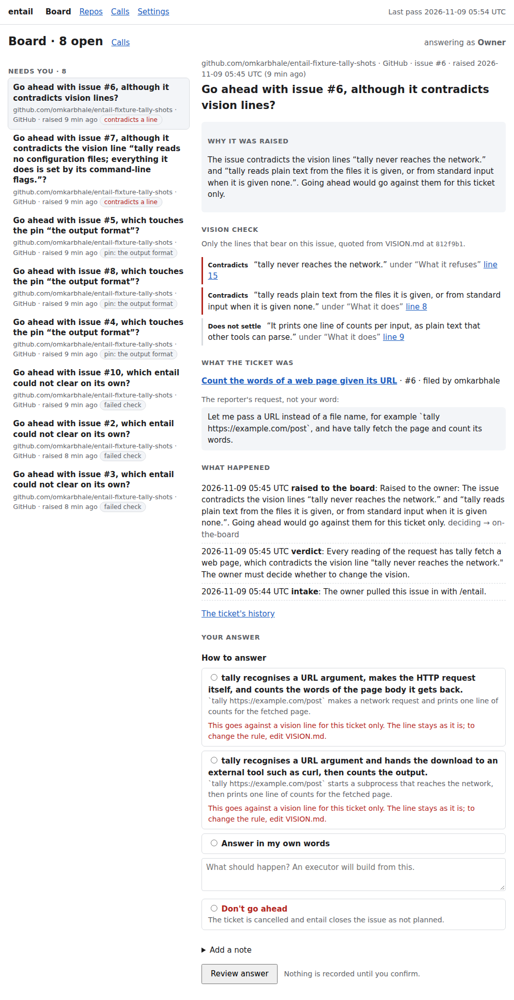
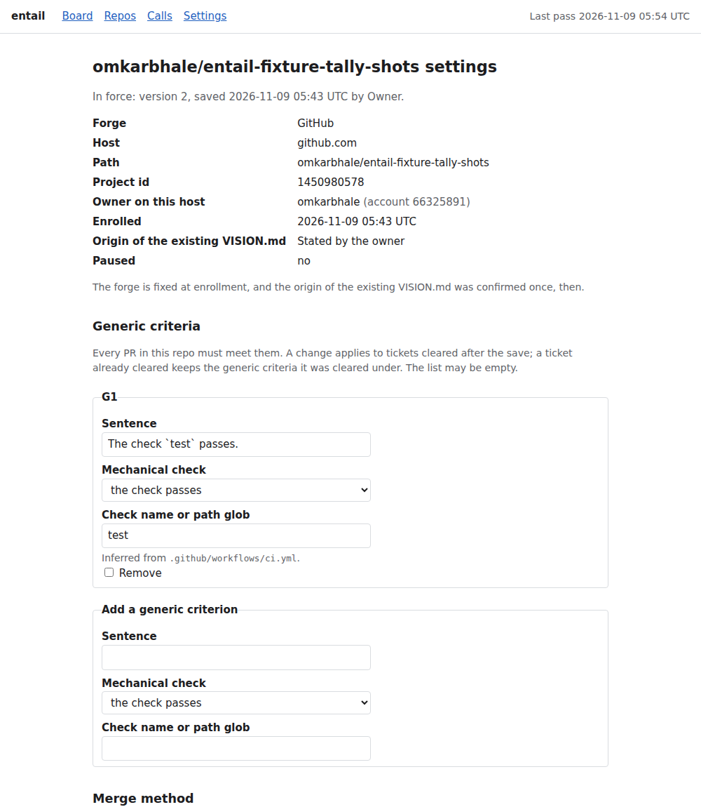
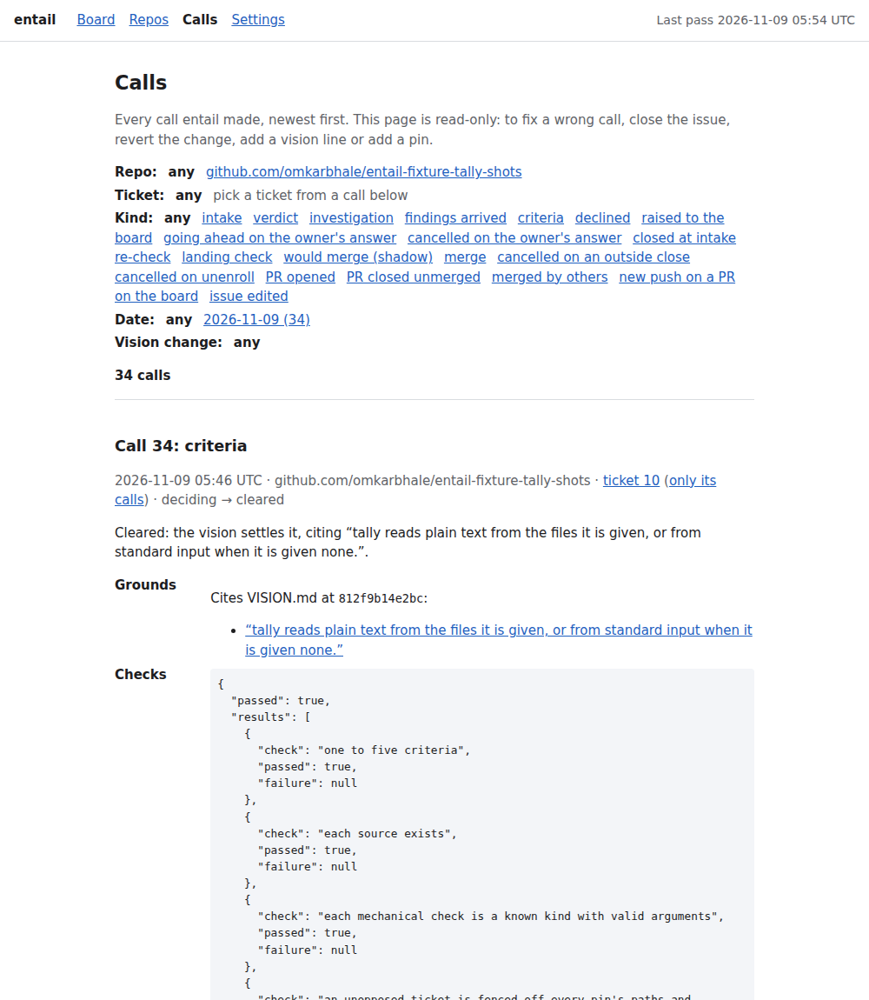

# entail

Keeps a product's vision in a file, uses it to decide which issues need you, and checks every PR against the criteria it wrote for the issue. Everything else happens without you.

You file an issue. entail judges it against your repo's `VISION.md`:

- **The vision settles it, or does not contradict it:** entail labels the issue `entail:cleared` and comments what the PR must contain. Any executor (a coding agent, a person) can pick it up.
- **The vision cannot settle it:** the question lands on a local board, with what the ticket was, why it was raised and the options. Nothing starts until you answer.
- **A PR arrives:** entail checks it against those criteria and your repo's generic ones (such as "the tests ran"), and merges it only if it passes.



*A board item: why it was raised, the vision lines that bear on it, and the form you answer it with.*

## Why

Agents can implement. What is missing is a durable record of what the product is and a rule for which decisions are yours, so today every decision comes back to you in chat and evaporates there. entail owns exactly one call: which decisions need the owner, judged against a vision of record. It never writes code, pushes or opens PRs; on the forge it only comments, labels, closes and merges. More in [PROBLEM.md](PROBLEM.md) and [VISION.md](VISION.md).

## Quick start

You need Linux (WSL included) or macOS, Node 24 or newer, `git`, the [`claude`](https://docs.anthropic.com/en/docs/claude-code) CLI logged in (entail runs its model work on your own subscription), and `gh` (GitHub) or `glab` (GitLab) logged in as you. The repo you enroll needs a `VISION.md` on its default branch; write one with the [/vision skill](https://github.com/kunchenguid/vision).

entail is not on npm yet, so install it from source:

```sh
git clone https://github.com/omkarbhale/entail.git
cd entail
npm ci
npm run build
npm link        # puts the `entail` command on your PATH
```

Then:

1. `entail run` starts it and keeps it in the foreground. It serves its pages on `http://127.0.0.1:7419/`.
2. Open `http://127.0.0.1:7419/settings` and set your display name.
3. Open `http://127.0.0.1:7419/repos` and enroll a repo: forge (`github` or `gitlab`), host and path. entail checks access and proposes generic criteria for you to confirm.

   

   *A repo's settings: its identity details and generic criteria.*

4. Open a new issue in that repo. Within a minute entail comments on it, or puts a decision on the board at `http://127.0.0.1:7419/`.
5. Answer board items there. The board form is the only way an answer enters entail.

Issues already open when you enroll are left alone; comment `/entail` as the whole first line of a new comment to pull one in. To run without a terminal, use `entail service install`. `entail status` shows what is running and what is wrong.

## How it works

```
  issue ──▶ decider ───────────────┬──▶ cleared: criteria on the issue ──▶ executor opens PR + evidence
 (yours)    judges it against      │                                                 │
            VISION.md + pins       └──▶ needs you: board item ──▶ your answer ──▶ criteria
                                                                                     │
                                         merge ◀── passes ── landing check ◀─────────┘
                                                              (criteria + generic criteria)
```

- **Vision of record.** `VISION.md` on the default branch is the only vision. Each line keeps a recorded origin (stated by you, proposed by an agent and approved by you, or added automatically with you notified), so an agent's proposal never reads as your word.
- **Decider.** A ticket goes to you if it contradicts a vision line, touches a pin (a topic you said always comes to you), or has readings the vision makes consequential. Otherwise it is cleared. Every "the vision settles this" cites the line it relied on, and every automatic verdict passes mechanical checks and an independent challenge first.
- **Board.** An inbox of product decisions only, oldest first. Answers are final, recorded under your name, and settle their own ticket.
- **Criteria at intake and at landing.** At intake, one to five outcomes with mechanical checks where possible. At landing, the PR's evidence is graded against them plus the repo's generic criteria.
- **Audit.** Every call is logged with its reason and the model runs behind it on the read-only Calls page (`/calls`), and your records are copied to a git repo you choose.



*The Calls page: every call, newest first, with the vision line it cited and the checks it passed.*

## Status

MVP-1, under development; the commands above work, but expect rough edges and no stability promises. It runs on one machine for one owner, on GitHub and gitlab.com or self-hosted GitLab 15.6 or newer. Not there yet: native Windows, GitHub Enterprise Server, splitting oversized tickets (they are declined), collaborators answering the board, rulings learned from repeated answers, and scheduled drift checks.

## Documentation

- [MVP-1 spec](docs/spec/mvp-1.md): the behaviour, requirement by requirement
- [GLOSSARY.md](GLOSSARY.md): what each term means
- [docs/adr/](docs/adr/): the decisions behind it
- [PROBLEM.md](PROBLEM.md) and [VISION.md](VISION.md): why it exists and what it should and should not become

## Development

```sh
npm ci
npm run typecheck
npm test        # node:test, running the TypeScript sources directly
npm run build   # compiles the server and bundles the board app into dist/
```

The acceptance test (`npm run acceptance`) and its harness (fixture repos, reset, scripted executor and board driver) are described in [test/acceptance/README.md](test/acceptance/README.md).
