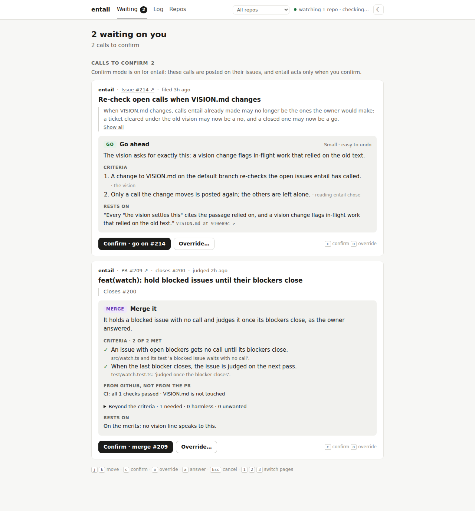
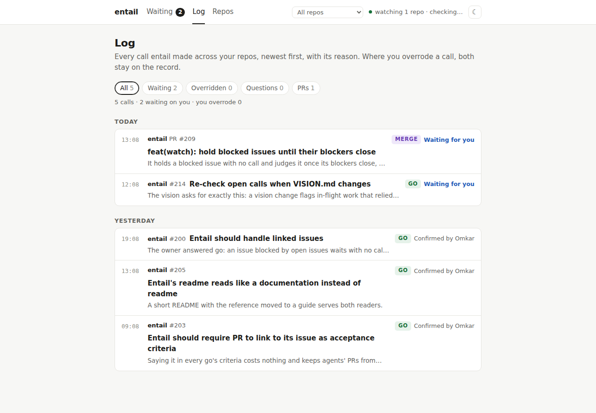
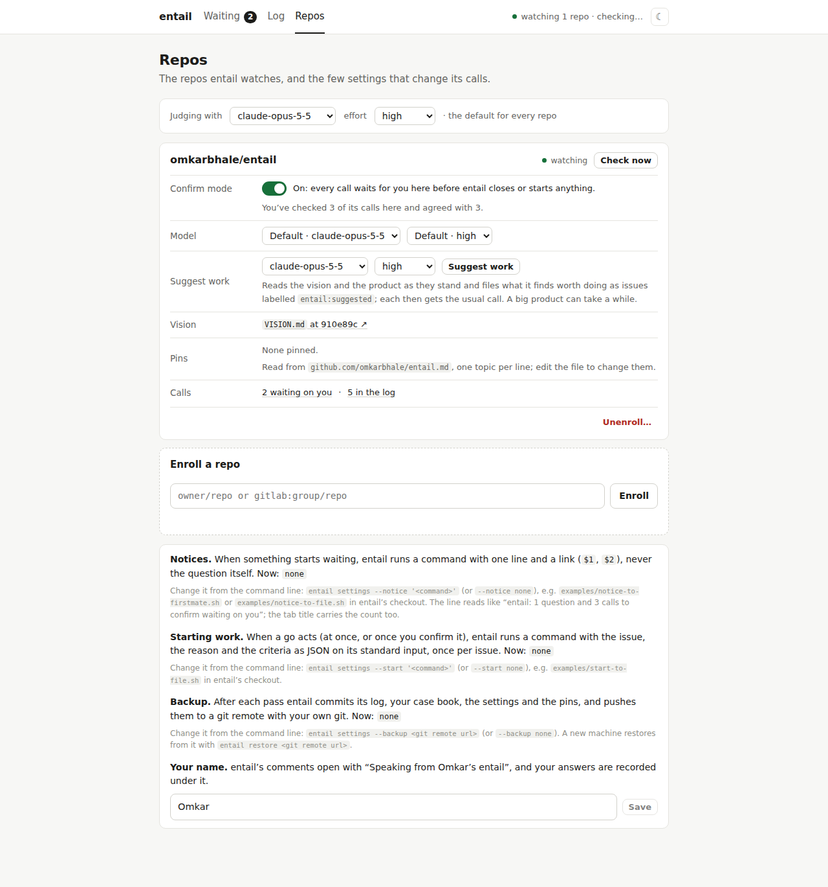
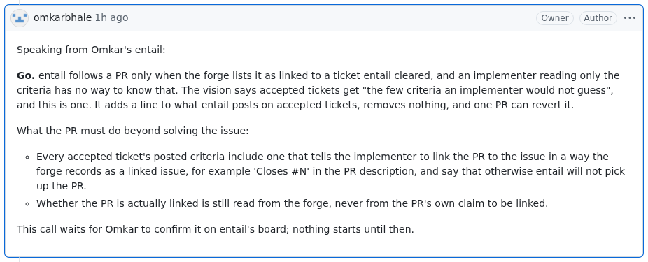

# entail user guide

The reference for running entail: every command, what it does on the forge, the board, and where it keeps its data. The [README](../README.md) is the short version.

## Commands
You need Node 24 or newer, `git`, `gh` logged in (or `glab`, for GitLab), and `claude` logged in.

```sh
npm ci && npm run build
node dist/cli.js enroll owner/repo             # watch a repo; it starts in confirm mode
node dist/cli.js run --dry-run                 # one pass that prints what it would post, and changes nothing
node dist/cli.js service install               # run entail now, at every login and after a crash
node dist/cli.js open                          # the board, on http://127.0.0.1:4380/
node dist/cli.js status                        # running or not, each repo's last check and confirm mode (and, while its checks fail, since when and why), what waits
node dist/cli.js settings --notice '<command>' # optional: told in one line when something starts waiting
node dist/cli.js settings --start '<command>'  # optional: a go hands its issue to this command to start the work
node dist/cli.js settings --send-back '<command>' # optional: a PR entail sends back or cancels is handed to this command
node dist/cli.js settings --backup <git remote> # optional: push the records to a git remote after each pass
```

From there the owner files issues and answers on the board; nothing else needs a terminal. The rest is there when wanted:

```sh
node dist/cli.js run                           # entail by hand instead of the service: poll every minute, post, serve the board
node dist/cli.js service status                # or: service uninstall, which stops and removes it
node dist/cli.js update                        # from entail's checkout: pull, build, restart the running entail on the new code
node dist/cli.js waiting                       # the questions and calls to confirm waiting on you
node dist/cli.js confirm owner/repo#12         # or: override owner/repo#12 no "reason", answer owner/repo#12 go "answer"
node dist/cli.js calls owner/repo              # the log: every call and every answer, with its reason
node dist/cli.js judge owner/repo#123          # the call on one issue, printed; it posts nothing
node dist/cli.js land owner/repo#124           # the call on one PR at its head, printed; it posts and merges nothing
node dist/cli.js replay                        # the case book through both judgments, agreement with the owner
node dist/cli.js backup status                 # the backup remote, its last push, and whether backup is stuck
node dist/cli.js restore <git remote>          # on a new machine: bring the records back from the backup remote
node dist/cli.js suggest owner/repo            # suggest work from the vision and the product, filed as entail:suggested issues
node dist/cli.js settings owner/repo --drift on   # check merged work against the vision on a schedule (--drift-every <days>, 7 by default; --drift off stops it)
node dist/cli.js drift owner/repo              # check the work merged since the last check against the vision now, filed as entail:drift issues
node dist/cli.js settings owner/repo --base develop # work against develop instead of the forge's default branch (--base default undoes it)
node dist/cli.js settings owner/repo --criterion "Tests were added or run" # a generic criterion every PR in the repo must meet (--criterion none clears them)
node dist/cli.js settings owner/repo --allow "Sam"   # let Sam answer this repo's board items (--disallow "Sam" takes it back)
```

`node dist/cli.js help` lists every command and option. Every setting `entail settings` changes is on the board too, once entail is running: the ones for every repo on its Settings page, each repo's own on its card on Repos.

## GitLab

A project on gitlab.com is served the same as a GitHub repo, with nothing left out: name it `gitlab:group/project` (subgroups included, as in `gitlab:acme/tools/tally`, or paste its `https://gitlab.com/...` address) wherever this page says `owner/repo`, on the command line and on the board's Repos page, and have `glab` logged in (`glab auth login`) beside or instead of `gh`. Everything below works there: calls, labels and marked comments on issues, `/entail` in a note, merge requests followed through GitLab's own "closes" link, CI read from the merge request's head pipeline and the changed files from its diffs (both from GitLab, never from the description), and merging at the judged head with the project's own merge method. GitLab records no close reason, so a no closes the issue plainly with its comment saying why, and when "Pipelines must succeed" is on the pipeline is the check GitLab requires. GitHub repos keep their names and their logs as before.

A project on a self-hosted GitLab (Community or Enterprise Edition, 15.7 or newer) gets the same, named `gitlab://host/group/project`, such as `gitlab://git.example.com/acme/tally` (subgroups included), or by pasting its address with `gitlab:` written before it, such as `gitlab:https://git.example.com/acme/tally`, on the command line and on the board alike; the `gitlab:` is needed because only you can say that a host runs GitLab, so an address on another host without it is not taken. Have `glab` logged in to that host (`glab auth login --hostname git.example.com`): entail reaches the host's API and its git through that login, as it does gitlab.com's. The host is a host name only, with no port. `gitlab:group/project` still means gitlab.com, whatever the group is called, so `gitlab:git.example.com/acme/tally` is a project on gitlab.com whose top group is `git.example.com`; and gitlab.com keeps that one name, so `gitlab://gitlab.com/acme/tally` is read as `gitlab:acme/tally`. A host, or a proxy in front of it, that drops a long response partway through does not stop entail: a list cut off that way is read again in smaller pages from the item where it was cut off, and only a read cut off even one item at a time is reported, as a dropped connection rather than an unreadable answer. Projects already enrolled keep their names and their logs. A host whose certificate is signed by a private certificate authority is refused by `glab` until it is told which CA certificate file to trust for that host, and that is `glab`'s own setting: git trusting the host through its own settings does not carry over. When enrolling, or any later read from the host, fails for that reason, entail says so in plain words and gives the step, `glab config set ca_cert /path/to/ca.pem --host git.example.com` (with the file git is set to trust for the host filled in when git names one). On the board's Repos page the failure comes with an offer to do it for you: it shows the host and the CA certificate file (the one git trusts for the host, or one you type), and only when you press **Trust the host with this file and enroll** (named for the host) does entail run that command, which writes that host's `ca_cert` in `glab`'s configuration and nothing else, and enroll again. entail never changes `glab`'s configuration on its own. `gh` has no per-host setting for this, and GitHub's host needs none; on the command line the steps are printed and nothing is changed.

## GitHub Enterprise Server

A repo on a GitHub Enterprise Server gets everything a repo on github.com gets, named `github://host/owner/repo`, such as `github://ghe.example.com/acme/tally`, or by pasting its address with `github:` written before it, such as `github:https://ghe.example.com/acme/tally`, on the command line and on the board alike; the `github:` is needed because only you can say that a host runs GitHub, so an address on another host without it is not taken. Have `gh` logged in to that host (`gh auth login --hostname ghe.example.com`): entail reaches the host's API and its git through that login, as it does github.com's. The host is a host name only, with no port. `owner/repo` still means github.com, so a repo already enrolled keeps its name and its log, and github.com keeps that one name, so `github://github.com/acme/tally` is read as `acme/tally`. The same `acme/tally` on a Server is another repo, with its own log under `log/_github-enterprise/<host>/` and its own pins.

A Server answers more slowly to new features than github.com does, and entail does not turn the gap into a lesser path. A Server has no `merge-async`, so a PR is merged with the merge endpoint, pinned to the judged head and with the repo's own merge method, and a draft or a PR the base branch's rules still block is refused before it is asked for, so the rules are not bypassed. A Server without the field that links an issue to the PRs closing it finds them from the PRs the issue's timeline shows mentioning it, keeping those whose own closing references name it; a Server without issue dependencies has no blocking links, so only the text names blockers. Enrolling asks the host for its version and refuses a host that reports none, such as a mistyped name; entail sets no oldest version.

## Running

`entail service install` writes a systemd user unit (Linux, WSL with systemd on), a launchd agent (macOS) or a Task Scheduler task (Windows) that runs the same `entail run`, with the same data directory and port, from login on and again after a crash; `entail service uninstall` stops and removes it, and `entail service status` says where it stands. Task Scheduler does not restart a crashed task, so on Windows log in again or run `entail service install` again to restart it. One copy runs per machine: the service and `entail run` by hand never run together. A crash or a restart loses nothing: every call and owner's action is in the log before entail acts on it, an action whose undo window closed meanwhile is completed, an undone one is dropped, and a comment already posted is found by its marker and never posted twice.

## Updating

`entail update`, run from entail's checkout, fast-forwards its branch (`git pull --ff-only`), runs `npm ci` and `npm run build`, and restarts the entail running from that checkout on the new code. Before the restart it asks the running entail to take no new work and waits for the pass in flight to finish, model runs and start commands included, so nothing is cut off partway; what comes due meanwhile is acted on after the restart. The service is restarted through its service manager and the board comes back with it; `entail run` by hand is stopped once idle, for you to start again. It refuses a directory that is not entail's checkout, uncommitted changes to tracked files, and an entail running from anywhere else, and a failed pull or build leaves the running entail alone.

## Watching

`run` polls each enrolled repo. Each issue filed after it was enrolled gets a call, and gets one again whenever its title or body is edited; a comment with a line starting `/entail` gets a call on its issue too, on any issue. Each call is one model run, Opus 5.5 at high effort unless the settings say otherwise (`entail settings`, for every repo or one; every one of them is on the board too, on Settings or the repo's card), paid on the logged-in `claude`.

## Generic criteria

A repo can have generic criteria: what every PR in it must satisfy whatever its ticket, such as that tests were added or run, that docs were updated or that a changelog entry exists. They are a setting fixed once per repo, never a question asked per ticket. Set them with `entail settings owner/repo --criterion "<text>"`, repeating `--criterion` for each one (the list replaces the earlier one; `--criterion none` clears it), or on the repo's card on the board's Repos page, one per line. Each change is logged under the owner's name like the other settings, and `entail repos` shows how many a repo has. They work the same on GitHub and GitLab.

- Every landing call on the repo checks them beside the ticket's own criteria: each is marked met or unmet with its evidence in the same checklist, on the board and in the comment, and an unmet one sends the PR back like any other. A PR with no cleared ticket is checked against them too.
- Where a criterion can be checked from what the forge reports, such as the checks that ran or which files the PR changes, that is its evidence; what the PR's description says about itself proves nothing.
- A posted go lists them after its own criteria, and the handoff to the start command carries them in its criteria with the source `owner`, so the implementer knows them before writing the PR.
- A repo with none set lands PRs exactly as before.

## The base branch

entail works against one branch of each repo: the forge's default branch, unless the owner sets another as the repo's base branch, for a project that starts its work from a branch such as `develop` and merges back into it. Set it with `entail settings owner/repo --base <branch>` (`--base default` goes back to the forge's default branch) or on the repo's card on the board's Repos page; each change is logged under the owner's name like the other settings, and `entail calls` shows it. With one set, entail uses it everywhere it would use the default branch: it reads `VISION.md` and the repo there for the call on an issue, for the re-check when the vision changes and for a suggestion run, follows and judges only the PRs that merge into it, diffs a PR against it, reads the checks its branch rules require, and merges into it. A PR into any other branch, the forge's default branch included, is not followed. A branch the remote does not have fails the repo's check, with that reason, until it is set right. Unset, nothing differs from a repo that never had one.

The base branch can be changed at any time on a repo already enrolled: set, moved to another branch, or unset back to the forge's default. The next pass works against the new branch:

- The mirror fetches the new branch, and the call on an issue, a PR's diff and a suggestion run read it from then on.
- Its `VISION.md` becomes the vision of record. When it reads differently from the one before, that is a vision change like any other: each open issue whose call was made under different lines is re-checked once, and only once.
- PRs followed into the old branch are followed no more (the log says it merges into another branch); their waiting calls leave the board, and a merge the owner confirmed before the change is refused rather than made into the old branch.
- The PRs already open into the new branch are read once and picked up as any changed PR would be, matched to their issues by the forge's link data or, with a base branch set, their head branch names.
- Each change is logged with who made it, and the pass that starts working against the new branch logs that too, with the PRs it picked up.

GitHub and GitLab may not link a PR to the issue it closes when the PR merges into a branch other than their default, even with `Closes #12` in its description. In a repo with a base branch set, a PR the forge links to no issue is matched by its head branch name instead, a fact the forge reports: each run of digits the name's separators (`/`, `-`, `_`, `.`, `#`) set apart that is an issue in the repo, so `12-word-count` or `fix/issue-12` is matched to #12. The PR's title, description and comments are never read for it. The same holds on GitHub and GitLab. So that work lands where entail follows it, a go in such a repo asks, in place of the usual line on linking the PR, for the PR to be opened into the base branch from a branch whose name carries the issue's number, such as `12-word-count`, and linked to the issue.

## Acting on the call

The call is posted on the issue, opening with "Speaking from <owner>'s entail:". A go carries its reason and the criteria the PR must meet; a go for planning opens "**Go, for planning.**", says the owner's workflow writes the plan and files the smaller tickets, and carries the criteria the plan must meet, always ending with one entail adds itself: link the PR to the issue so GitHub lists it under the PR's Development section (for example `Closes #N` in its description), since a PR that is not linked is judged on the vision alone, without the issue's criteria. That line is not stored in the log or given to the landing call; whether a PR is linked is read from GitHub, never from the PR's claim. A no carries its reason, quotes the vision lines it rests on, and closes the issue as not planned. An ask posts only a note that a question is waiting on the board; the question and its answer stay off GitHub. Every comment carries a hidden marker with the id of the log entry it speaks for, so a restart finds what it already posted and never posts it twice. As a call acts, the issue also gets one label: `entail:go` for a go, `entail:plan` for a go for planning, `entail:no` for a no as it closes, and `entail:ask` while a question waits on the board, swapped for the next one when an answer, an override or a changed call acts; a label GitHub refuses holds the act for a retry next pass, and only an account that cannot label (it lacks triage access, or the repo has issues off) lets the call go ahead without one, with `entail status` and the board's repo card saying why.

## When the vision changes

Each pass compares `VISION.md` on the base branch (the default branch unless [another is set](#the-base-branch)) with the text entail last saw; a change of headings, order or spacing alone is none. When its lines change, entail logs the change and re-checks, once, each open issue whose posted call (a go, a no the owner overrode or that was reopened, or a question still waiting) was made under the earlier text, in log order, one model run each, printing its progress. The re-check is the same judgment as for a new issue, reading the issue as it was judged, the new vision, and also the earlier call and the vision lines the change removed and added, with the instruction to change the call only when the change requires it. When the call holds (the same go, no or ask), the re-check is logged with its reason and nothing is posted. When it moves, the new call is posted as a changed call: the comment says the vision changed, shows the call before and after, quotes the removed or added line that moved it, and carries the new call as any call would, label included. If the issue has an open PR entail follows, the comment says that PR relied on the old text, and the PR gets one comment pointing at the issue. Confirm mode applies as for any call, so a go that became a no closes the issue only once the owner confirms it; the board's card shows the call before → after and the vision passage. A change to a call the owner made themselves always waits for the owner, whatever the mode. Closed issues, a cancelled PR's question, landing calls and merged work are not re-checked; `/entail` on a closed issue brings it back. A re-check that gives no call is tried again on the next passes, up to three times.

## Collaborators

By default only the owner answers a repo's board items. The owner can let a collaborator answer for one repo: `entail settings owner/repo --allow "Sam"`, or **Collaborators** on the repo's card on Repos, adds the name and `--disallow` (or Remove) takes it back, voiding any answer of theirs still in its ten-second hold, each logged under the owner's name. A repo with no collaborators set behaves exactly as before, and only the owner grants or removes the permission: a collaborator's request to change a setting, confirm a call or override one is refused. The owner's own name cannot be given to a collaborator.

A collaborator answers a question, on an issue (go, plan or no) or on a PR (merge or send-back), by the same path as the owner: `entail answer owner/repo#12 go "words" --as Sam`, or on the board's API with `"as": "Sam"` in the answer. It is held for the same ten seconds, which only that collaborator or the owner can undo, and settles the ticket the same way: a go runs the judgment again on their word, a no closes the issue. It is stored with `collaborator` set and shown, posted and logged under their name, "Sam (a collaborator)" on the board and in `entail calls`, never as the owner's: the comment on the issue reads "on the answer of Sam, a collaborator Omkar allowed to answer on the board. It is Sam's word, not Omkar's own", and the judgment reads it as Sam's. It is not written to the owner's case book, which holds the owner's own calls and is what a replay compares against. A question about a PR that changes `VISION.md` or a pinned path stays the owner's alone to answer, since only the owner lets those merge. A collaborator's answers count toward a [learned ruling](#learned-rulings) like the owner's, each under their name.

When a collaborator's answer [grows the vision](#the-vision-grows-from-answers), the line is recorded as theirs: the `vision-grown` entry carries `collaborator`, the commit message says "Answered by Sam, a collaborator the owner allowed to answer; not stated by the owner", and the owner is told with "from Sam's answer on #12 (a collaborator's, not stated by you)". `VISION.md` still carries no mark. A collaborator's name is a label for attribution, not a security boundary: use their forge username. The board and its API answer only on the loopback host, where anyone who can reach it can already act as the owner, so anyone who can reach the local board can answer as any allowed collaborator. Authenticating collaborators belongs with remote access to the board (#67).

## The vision grows from answers

After a board answer settles its own ticket (an answer to a question on an issue or on a PR, the owner's or an allowed collaborator's, once its ten-second undo window has closed), one model run reads the question, the answer and `VISION.md` and decides whether the answer makes sense as a general statement of the product: something that holds beyond this ticket, that the vision does not already say or contradict, and that reads as one line in the vision's own voice. Most answers are rulings on one ticket and add nothing; the run is told to add nothing when in doubt, and a vision that grew with every answer would be padded, so months of daily answers should grow it very little. When an answer does qualify, entail does not wait for the owner: it writes the line into `VISION.md` on the [base branch](#the-base-branch) itself, as one commit of its own (at the end of the section the run chose, the rest of the file untouched, pinned to the version it read so a file that moved is refused, not overwritten), and tells the owner. On GitHub that is a commit through the contents API, and on GitLab through the repository files API; a protected base branch that refuses it fails the write, which is logged and tried again each pass without another model run, and the line is never written twice.

The line's origin is kept outside `VISION.md`, which carries no mark of it: the repo's log holds a `vision-considered` entry for every answer weighed (what the run decided and why, the model and the prompt version, adding nothing included) and a `vision-grown` entry for every line added, with the answer's entry and the call it answered, who gave the answer, the issue or PR, the line, the section, the reason and the commit. `entail calls` prints them ("added to VISION.md ... automatically, from Omkar's answer on the board"), and each pass prints the line it added. The owner is told by the [notice command](#notices) with the line itself and a link to `VISION.md` at the commit, once per line, so nothing is added silently; with no notice command set the log and `entail calls` still say so. The owner can take a line back by editing `VISION.md` like any change to it.

A line added is a vision change like any other, which each pass notices on its next read: the open issues whose call was made under the earlier text are [re-checked once](#when-the-vision-changes), and a call the new line moves is posted as a changed call that says the vision changed and tells each open PR for the issue that it relied on the old text. An answer given before this was added is never weighed, and a repo with no `VISION.md` grows nothing, since a vision is first written by the owner (with the /vision skill). The prompt is in `src/vision-growth.ts`.

## Blocked issues

An issue blocked by another issue that is still open gets no call, no criteria and no work. It is blocked when its title or body says so ("blocked by #12", "depends on #12", or `owner/name#12` for another repo, case-insensitive, outside code) or when the forge links it to a blocking issue (GitHub's issue dependencies); whether each blocker is open is always read from the forge. entail holds the issue instead: it posts one comment naming the open blockers and saying it picks the issue up again when the issue is edited (for example to remove a blocker), on an `/entail` comment, or when the blockers close, and puts on the `entail:blocked` label. A held issue is weighed again when it changes, when GitHub reports a change to one of its blockers in the same repo, and, for a blocker in another repo, by reading that blocker's state each pass; while the same blockers stay open nothing new is posted, and a changed set of blockers, or an `/entail` comment, posts a new note. Once none is open the issue is judged as usual and the call's label replaces `entail:blocked`. Where GitHub's dependencies cannot be read, only the text counts and the note says so. On a GitLab project the forge's links are the issue's links of type "is blocked by", which only GitLab Premium and up can make; on the Free tier none blocks, so the text names the blockers, and each blocker's state is read from GitLab. A hold is not a call: nothing waits on the owner for it, confirm mode does not touch it, and it shows in `entail calls`, in `entail status` and on the repo's card, and in the trail of the call that follows it on the board's Log.

## When an issue entail closed is reopened

Reopening is how the owner disagrees with a no: the vision says a ticket that plainly goes against a vision line is closed quoting it, and the owner reopens it to change the vision. When a pass finds an open issue whose last act was entail closing it, it logs the reopen and reads the forge for who reopened it (GitHub's issue events, GitLab's state events); the reopen is the owner's only when that account is the one the owner's CLI is logged in as for the host.

- **The owner reopened it.** No model runs. The issue comes to the owner on the board as a question that carries the no and the vision lines it quoted, and the issue gets `entail:ask` and a comment saying it is theirs to settle, quoting the same lines; nothing closes or starts until it is answered. The answer settles that ticket, recorded under the owner's name, the same as any answer: a go runs the judgment again with the owner's word for the criteria, and a no closes the issue again with their words. It does not edit `VISION.md`; an answer enters the vision only as a board answer does, when it makes sense as a general statement.
- **Anyone else reopened it, or the forge names no one.** It is not the owner's word and not an override. entail makes the normal intake call again on the issue's current text, with the same judgment as for any issue. If the call is still a no, the issue is closed again with its reason, even in confirm mode, since the owner's confirmation of the first no has not changed; a go or a question is posted as it would be for any issue (a go waits for confirmation in confirm mode). A judgment that gives no call is tried again on the next pass.

The log, the board's Log page and `entail calls` say that the issue was reopened, and by whom.

## Landing a PR

`run` also follows each open PR into the [base branch](#the-base-branch) that GitHub's own link data says closes an issue whose go has acted (or, in a repo with a base branch set, that its head branch name names when GitHub links it to none). Once CI has finished at a head entail has not judged, one model run reads the issue, the vision, the criteria the go set, the diff, the checks and the changed files (both read from GitHub, never from the PR's description) and answers merge, send back or ask, with a plain reason. Each criterion is marked met or unmet with the evidence relied on, and anything the PR does beyond its criteria is sorted needed (to do the job), harmless or unwanted; only something unwanted, an unmet criterion, the problem unsolved or CI not green sends a PR back. A merge happens at the exact head that was judged, squashing unless the repo allows only other methods; a new push is judged again. Two rules no model decides: a PR whose CI is not green at the judged head is never merged, and a PR that changes `VISION.md` or a pinned path (a pin naming a path, such as `src/billing/`) merges only on the owner's answer. Pins are added and removed on the board's Repos page or with `entail settings <owner/repo> --pin <topic>` and `--unpin <topic>` (each repeatable, and the command lists the pins), each change logged with your name like any setting; the pins file at `pins/<host>/<owner>/<name>.md` is the one record, so a hand edit of it works as before. A send-back is posted on the PR as what needs to change; entail never changes the PR itself. After three send-backs, the next one cancels the PR: it is closed with the reason, and when what blocked it is a product call, the issue's question goes to the owner. The prompt is in `src/landing.ts`.

A PR with no cleared ticket behind it is landed too: one to the base branch, not a draft, that GitHub links to no issue whose go has acted, either because it closes no issue or because the go on the issue it closes still waits for the owner's confirmation (or the issue's call is a question or a no). entail follows it and, once CI has finished at an unjudged head, judges it on the vision and the product alone: there are no criteria, the question is whether it leaves the product better, and everything it does is sorted needed, harmless or unwanted against the vision. It merges when the product is left better, nothing is unwanted and CI is green; otherwise it is sent back with what needs to change, or the owner is asked, and the same two rules and confirm mode apply. The comment opens the same way as any other and says no cleared ticket is behind the PR, with the vision lines the call rests on; the board and `entail calls` show "no ticket" where the issue would be. Such a PR is never cancelled, since there is no ticket to cancel. Once a go on an issue it is linked to acts, the PR is followed with that issue and judged again, at the same head, against the go's criteria. On a repo with no `VISION.md` on its base branch there is nothing to judge such a PR against: it gets no model run and no merge or send-back, entail says once that it skipped the PR and why, and the owner merges it by hand. `entail land` judges a PR that closes no issue the same way.

## Confirm mode

A repo starts in confirm mode: entail posts its go or no but closes nothing until the owner confirms it. The owner can instead override a call with their own go, plan or no and a reason (plan is a go for planning; an override or answer of go is a go to implement unless the owner picks plan), which is posted on the issue (reopening it for a go) and replaces the call. A question is answered with the owner's go, plan or no and their words; on a go the judgment runs again with the answer as the owner's word, for the criteria. On an issue that lists several suggestions (two or more items in a list in its own words), the owner can instead take only some of them: on the board a fourth answer, "Take only some of the parts", ticks the parts to take, and `entail answer owner/repo#12 no "words" --accept 1,3` does the same from a terminal (`entail waiting` numbers the parts from 1). It is recorded through the same answer path as any answer, under the owner's name, as a no on the issue with the parts taken and turned down, and is held for the ten seconds like the rest. When it acts, entail files one new issue for each part taken (the part's words, a line saying where it came from, a hidden marker so a restart never files one twice, and no label), which go through ordinary intake like any issue, then posts on the original a comment that links them and names the parts turned down, and closes it with `entail:no`. The original closes only once every part is filed. The parts are the items of the list as written, read the same way every time, with no model run. A go can also be overridden with a go made differently: the owner's one line is posted word for word as the criterion, in place of entail's. On a PR the same happens with merge or send-back: in confirm mode a merge call is posted but nothing is merged until the owner confirms it, and a cancel closes nothing until confirmed. Every confirmation, override and answer is recorded under the owner's name and written as a case to the owner's case book. The label follows the confirmation: a call waiting to be confirmed carries none, and its `entail:go`, `entail:plan` or `entail:no` goes on when the owner's confirmation, override or answer acts. The owner turns confirm mode off per repo (on the board, or `entail settings owner/repo --confirm off`) once entail stops being overridden; the board suggests it after five checked calls with at least 80% confirmed, counting confirmations and overrides only, on issues and PRs alike.

## The board

`run` serves the board on `http://127.0.0.1:4380/`: every enrolled repo and every call, on issues and PRs, in one place, on four pages that never reload. **Waiting** is one column of open cards, questions first and then calls to confirm, oldest first within each; each card says what the ticket (or the PR) was, what entail concluded, why it was raised and the vision line or past case it rests on, and is confirmed, overridden with a one-line reason, or answered in place (`j`/`k` move, `c` confirm, `o` override, `a` answer, `Esc` cancel, `1`/`2`/`3`/`4` switch pages). A PR's card says merge or send back, shows the criteria as a met/unmet checklist with evidence, a line from GitHub (CI checks, whether `VISION.md` was touched) that does not come from the PR, and, collapsed, what the PR does beyond its criteria. An action is recorded at once and held for ten seconds with an Undo, on an issue and on a PR alike; entail writes it to the case book and acts on GitHub (posts, closes or merges) when the window closes, and a restart completes it without acting twice. **Log** is every call on issues and PRs, newest first and paged by day, never trimmed, with the owner's call kept beside entail's; a call entail made alone can be overridden from it. **Repos** holds enrolling (with the issues already open offered as a separate click) and each repo's own settings: confirm mode, its model and effort over the defaults, its [base branch](#the-base-branch), and its pins, each added with Pin and removed with Unpin. **Settings** holds every setting for every repo that `entail settings` changes: the default model and effort, your name, the notice command, the start command, the send-back command and the backup remote (with when it last took a push, or why it is stuck). A command or the remote is shown verbatim (the remote with any password hidden) and read only until Edit, a command says that entail runs it with the shell as you, and each is saved only on a second click that shows what it will be. Changing a setting is not a board item: nothing is posted, asked or logged as a call, and a change made with `entail settings` from a terminal shows on the page at once. How entail is started (`entail run --port`, `--interval`) is not a setting and stays on the command line. The tab title carries the count. The board follows the system's light or dark theme until the toggle in its navbar picks one, which it remembers. The board is a React app built into `dist/board` by `npm run build`, and its source is in `board/`.







A call as entail posts it on the issue:



## Notices

When something starts waiting, entail can run one command the owner sets (`entail settings --notice '<command>'`, or `--notice none`, or on the board's Settings page) with one line and a link appended as its last two arguments (`/bin/sh -c`, so `$1` and `$2`; on Windows `cmd.exe /d /s /c`, so `%~1` and `%~2` in a batch file), such as `entail: 1 question and 3 calls to confirm waiting on you http://127.0.0.1:4380/#/waiting`; never the question itself. The same command is told once when a repo's checks have been failing for 10 minutes (gh logged out, the repo gone or out of reach, the claude usage limit or a GitHub rate limit, with when it resets, or a model run erroring), as in `entail: owner/repo has been failing for 12 minutes: the pass: gh: not logged in`, and once when it works again (`entail: owner/repo is working again`), never on every poll and never twice for one run of failures, even across a restart. A PR whose landing judgment gave no call three times at one head is not failing and not recovered but stalled: it is told once per head (`entail: owner/repo stalled: PR #124 judged 3 times without an answer: <reason>; judged again on the next push`), and a new push clears it; meanwhile `entail status`, the repo's card on the board and a line atop the Waiting page say since when it fails and why. A line [added to the vision from an answer](#the-vision-grows-from-answers) is told once too (`entail: added to owner/repo's VISION.md from Omkar's answer on #60: <the line>`, with a link to `VISION.md` at the commit), the one notice that states the change, since nothing waits on the owner. A failure changes no call and polling goes on. [`examples/`](../examples/) holds a command that appends the line to a file (`notice-to-file.sh`, or `notice-to-file.cmd` on Windows) and one that drops it into firstmate's inbox. By default there is none.

## Starting work

When a go acts (at once with confirm mode off; once the owner confirms it, answers go or overrides to go when it is on), entail can run one command the owner sets (`entail settings --start '<command>'`, or `--start none`, or on the board's Settings page) with `/bin/sh -c` (`cmd.exe /d /s /c` on Windows) and the handoff on standard input as one line of JSON: the repo, the issue's number, URL and title, the call's reason, the criteria with their sources, `scope` (`"implement"`, or `"plan"` for a go for planning, which hands the owner's workflow the plan to write, the smaller tickets to file and the issue to close), and the `VISION.md` commit, plus `baseBranch` when the repo has [a base branch](#the-base-branch) set, the branch the work starts from and the PR merges into. Never on a no or an ask. Work is not started twice for an issue (a later go retries only after a start that failed); entail records that a start has begun before it runs the command, so if entail stops in the middle of one (a crash, a reboot, a force-stop) the start is never run again on restart: the log says it was interrupted and why, and it is not a question on the board; the log records that it started, by which command and with what exit status, and a command that fails is recorded and never holds up the call. entail depends on no executor: [`examples/start-to-file.sh`](../examples/start-to-file.sh) (or [`start-to-file.cmd`](../examples/start-to-file.cmd) on Windows) appends the handoff to a file. The PR that later closes the issue is judged at landing like any other. By default there is none.

## Handing a sent-back PR to a command

When entail sends a PR back, or cancels it (closes it unmerged), it can run one command the owner sets (`entail settings --send-back '<command>'`, or `--send-back none`, or on the board's Settings page), so the work is picked up again without the owner telling anyone. It runs once per send-back or cancel: whether the call is entail's own, the owner's confirmation of it (for a cancel with confirm mode on, once the owner confirms the close) or the owner's override to send back. Never when a PR merges, is raised to the board or is asked about. The command is run as the start command is (`/bin/sh -c`, `cmd.exe /d /s /c` on Windows, stopped after 60 seconds) with the handoff on standard input as one line of JSON: the repo, `outcome` (`"send-back"`, or `"cancel"` for a PR closed unmerged), the PR's number, URL and title, the issue it closes (null with no cleared ticket behind it), the judged `head`, `call`, `by` (`"entail"` or `"owner"`), the `reason`, `needsToChange`, the `checklist` (each criterion marked met or unmet, with evidence) and the issue's `criteria`, plus the owner's words as `ownerWords` when an override sent it back. It runs after the comment is posted and the act is recorded, so its failure, timeout or output never changes or delays the call or the comment: the log records that it ran, by which command and with what exit status. entail never touches the PR itself and depends on no executor: [`examples/send-back-to-file.sh`](../examples/send-back-to-file.sh) (or [`send-back-to-file.cmd`](../examples/send-back-to-file.cmd) on Windows) appends the handoff to a file. By default there is none.

## Checking merged work for drift

On a schedule, entail checks the work merged into a repo against its current vision and files an issue for each place it drifts. The check is a per-repo setting, **off until you turn it on**: **Drift check** on the repo's card on the board (off, every day, week, two weeks or month), or `entail settings owner/repo --drift on|off` and `--drift-every <days>|default` (a whole number of days from 1 to 365; the default is 7). Each change is logged under your name like the other settings. While `entail run` runs, a repo whose check is on is checked as soon as it is turned on and then each interval after the last check; a check that gives no answer is tried again after six hours, or the interval when that is shorter. `entail drift owner/repo [--model <model>] [--effort <level>]` makes the same check now. Checks run after a pass, one repo at a time, with the repo's own model and effort; a check ends after 20 minutes, and the next pass waits for it.

One check is one model run. It reads `VISION.md` and the repo at the base branch's head (the default branch unless [another is set](#the-base-branch)), the commits merged into that branch since the last check (the latest 50 on the first check, or when the last-checked commit is no longer in the branch; at most 200 are listed, newest first, each with the paths it changed), and the drift issues filed before, open and closed. It answers with each place the merged work departs from the vision, each quoting the vision line it drifts from, and what it looked at and left out, with why. Work the vision is silent on is not drift. If nothing merged since the last check, or the repo has no `VISION.md`, no model run is made, and the log says so.

Each finding is filed as an ordinary issue labelled `entail:drift`, written as an issue and naming whose entail found it so its words never read as yours, quoting the vision line it drifts from and listing the merged commits; at most five are filed from one check. It then gets the usual call like any new issue and keeps that label beside the call's. Nothing goes on the board as a question. A finding is not filed again while an open drift issue is on the same vision line (or has the same title), however the model words it: its hidden marker names the line. A closed drift issue does not stop a later finding, but is shown to the model, which is told not to repeat what was answered unless the merged work since made it worse. Each filed issue also carries its check's hidden marker, so a restart never files one twice. The log shows each check with what it found and left out, and `entail calls` prints the same; the repo's card on the board shows how the last check went. The prompt is in `src/drift.ts`.

## Suggesting work

On demand, entail suggests what should happen next in a repo from its vision and the product as it stands: **Suggest work** on the repo's card on the board, with the model and effort you pick (the repo's own by default), or `entail suggest owner/repo [--model <model>] [--effort <level>]` (`gitlab:group/project` for GitLab, `gitlab://host/group/project` on a self-hosted GitLab, or `github://host/owner/repo` on a GitHub Enterprise Server, where it works the same way). One run reads `VISION.md`, the README and the tree at the base branch's head (the default branch unless [another is set](#the-base-branch)), the open issues and the suggestions filed before and since closed (so nothing filed is suggested again) and your past calls on the repo, and may take up to an hour on a big product. It files each suggestion as an ordinary issue labelled `entail:suggested` (a suggestion larger than one PR as one larger issue), which then gets the usual call like any new issue and keeps that label beside the call's; nothing goes on the board as a question. Each filed issue carries the run's hidden marker, so a restart never files one twice. The log shows each run with what it filed and what it considered and left out, with why; `entail suggest` prints the same. One run per repo at a time. Not part of this: scheduled suggestion runs, and suggestions shown on the board for you to pick from before anything is filed.

## The board's API

The board reads and writes through a small JSON API on the same address, the single path that records answers; the browser never talks to GitHub. It serves what is waiting and what is held in its undo window (`GET /api/waiting`), the log by day (`GET /api/log`), one call (`GET /api/calls/:id`), confirm, override, answer and undo (`POST /api/calls/:id/confirm|override|answer|undo`), the repos (`GET|POST /api/repos`, `PATCH|DELETE /api/repos/:owner/:name`, `POST /api/repos/:owner/:name/check|backlog|suggest`; `PATCH` takes `confirm`, `model`, `effort`, `baseBranch`, `drift` and `driftEveryDays`), the settings (`GET|PATCH /api/settings`), entail's status (`GET /api/status`) and live updates as server-sent events (`GET /api/events`). `src/api.ts` documents each. Each call it returns carries `kind`, "issue" or "pr"; a PR's call also carries `pr`, with the criteria checklist, the facts read from GitHub, the beyond-the-criteria sort and what entail did on the PR. It answers only on the loopback host, and takes writes only as JSON from no other origin.

## What entail keeps

Everything lives in entail's data directory (`~/.local/share/entail` on Linux, `~/Library/Application Support/entail` on macOS, `%LOCALAPPDATA%\entail` on Windows): one append-only log per repo in `log/github.com/<owner>/<name>.jsonl` (`log/gitlab.com/<group>/.../<name>.jsonl` for a GitLab project, and `log/<host>/<group>/.../<name>.jsonl` on a self-hosted GitLab, and `log/_github-enterprise/<host>/<owner>/<name>.jsonl` on a GitHub Enterprise Server) holding every enrollment, setting, call on an issue or a PR (with what it read), owner's action, post and merge, from which everything shown is derived; the owner's case book in `cases/`; pins in `pins/<host>/<owner>/<name>.md`, one topic per line (the board and `entail settings <owner/repo> --pin`/`--unpin` write this same file, and a hand edit is read as it is); which waiting items the owner was last told about, and which repos they were told are failing, in `notices.json`; the lock held by the running copy in `entail.lock`; and the settings, mirrors, cursors and operational log. With a backup remote set, the directory is also a git repository holding the records; see [backing up](#backing-up).

## The call on an issue

`judge` reads the issue and its comments, the repo's `VISION.md` and the repo itself at its base branch (the default branch unless [another is set](#the-base-branch)), the owner's pins for the repo, and the most relevant past cases, and answers go (with the criteria the PR must meet), no (with the reason) or ask (with the one question). A go comes in two shapes: a go to implement, for work that fits one PR, and a go for planning, for a ticket too large for one PR, whose criteria are the ones the plan carries. A go for planning is for size alone: a change that is hard to undo (it removes or replaces something users rely on, changes stored data or a public interface, touches the vision or a pin, or cannot be undone by reverting one PR) is always ask, however large. entail never splits or plans a ticket itself, and never closes the original: the owner's workflow, handed the go for planning, writes the plan, files the smaller tickets (each judged on its own) and closes the issue with links to them. An issue that states a problem and no solution gets a solution chosen by entail, stated in its criteria as a reading ("Read as: ..."); it is asked only when the change is hard to undo or the possible solutions would give users noticeably different results. An issue that asks for a change everywhere something is done, or lists the places in the repo a change touches, has the repo searched for the places its list leaves out, and a go names each one by its path in a reading criterion; places the issue names are not restated, and an issue that names no places gets no criterion listing files. The prompt is in `src/judgment.ts`.

## Learned rulings

Board answers earn autonomy. When the call on an issue is ask, the judgment also names the kind of question it is (`question_kind`: a few lowercase words joined with hyphens, such as `new-dependency`), and the prompt lists the kinds the repo's board has already been asked so the same kind is named the same way again. Once a repo's board has answered one kind of question the same way three times, with no answer to it that goes the other way, the next question of that kind is settled by the ruling those answers earned instead of going to the owner: a go (or a go for planning, or a no) whose reason says so, that cites each answer it rests on under the name of whoever gave it, and that is logged and posted like any other call. In confirm mode it still waits to be confirmed, as a call to confirm and not a question; with confirm mode off it acts at once. The comment on the issue names who answered what and on which ticket, never the question or the answer's words, which stay on the board, where the call's card lists them.

A ruling never settles more than it earned:

- Only a question that would have gone to the owner is considered; a go or a no the judgment made itself is made, and comes out, as it would without rulings.
- A question about a change that is large or hard to undo always goes to the owner, and so does one that mentions a pinned topic (a mechanical check on the issue and the question, on top of the judgment's own). Answers to a hard-to-undo question never count toward a ruling.
- Answers must agree exactly: go, go for planning and no are different answers. An answer to that kind of question that disagrees, whenever it was given, stops the ruling being used, and so does the owner overriding a call a ruling settled to something else; it does not come back. An answer still in its undo window, or undone, does not count.
- The owner's own word is never replaced: an override or an answer to go runs the judgment again as the owner's call, not a ruling's.
- A ruling is derived from the repo's log each time and is never written to `VISION.md` or anywhere else; the vision grows only as [the vision is the record](../VISION.md) says.

Questions logged before kinds were named have none and earn nothing. Rulings are per repo; the three answers are `RULING_MIN_ANSWERS` in `src/rulings.ts`. A vision change re-checks a call a ruling settled like any other, and a question it would send to the owner is settled by the ruling the same way, unless the call being re-checked was the owner's own. Replaying the case book reads no answer history, so it never settles by a ruling: it replays the judgment as it stands.

## Backing up

entail's records (each repo's log, your case book, the settings and the pins) live only in its data directory, so losing that folder would lose every call, every confirmation and every case. To keep a copy elsewhere, name a git remote: `entail settings --backup <git remote url>`, such as a private repository on GitHub or GitLab (`git@github.com:you/entail-records.git`), a bare repository on another machine, or anything else your `git` can push to. Backup is off until you do, and nothing is pushed anywhere before that; `--backup none` turns it off again. entail pushes with your own `git` and whatever credentials it already uses for that remote (an SSH key, a credential helper, or a token you write into the URL yourself, which entail hides wherever it shows the remote); it holds no token of its own. The remote can also be set on the board's Settings page, which shows it with when it last took a push.

With a remote set, the data directory is also a git repository (`.git` inside it; no file moves). After each pass, and so after each of your confirmations and answers acts, entail commits whatever changed among the records with a one-line message and pushes it to the remote's `main` branch. A `.gitignore` entail writes keeps everything else on this machine: the lock, the mirrors and checkouts, the cursors, `notices.json` and the operational log are never committed. Setting the remote while entail is not running pushes at once; a running entail pushes after its next pass. A push that cannot get through (the network, credentials, a remote not created yet) is recorded in the operational log and tried again after the next pass.

One machine writes to the remote; any other only restores from it. If the remote has moved on since entail last pushed, as when a second machine pushed to it or it was changed by hand, entail neither merges nor overwrites it: it keeps committing locally, stops pushing, writes `backup-stuck` with the reason to the operational log, and says so in `entail status`, `entail backup status` (which then exits 1) and on the board's Settings page. Sort the remote out by hand in the data directory with `git`, for example by pushing this machine's history over it with `git push --force origin main` once you are sure it is the one to keep, or by resetting the remote to the commit entail last pushed; entail resumes on the first push that fast-forwards the remote.

To restore on a new machine, install entail and, before it has run there, run `entail restore <git remote url>`. It clones the remote into the empty data directory, so the log, the case book, the settings and the pins come back where entail reads them, and prints what it restored. It refuses a data directory that holds anything. Restore clears the backup remote in the restored settings, so the restored copy does not push until you run `entail settings --backup <git remote url>`: one machine writes, a restored one only restores. Not part of this: several machines writing to one remote, scheduled backups, and encrypting the remote.

## The case book and replay

The case book is [`cases/`](../cases/) and the owner's own `cases/` in the data directory, whose cases win for the same issue: each case holds the issue as it stood (`issue.md`), `VISION.md` at the commit the call was made against (`vision.md`), and the owner's call with its reason and where that reason comes from (`call.md`). A go's `call.md` can also say what the go's criteria must name, as a `must-name:` line of comma-separated text such as a path, when the owner said the go should have carried it, for example a place in the repo the issue's own list of places left out; replay then counts the go as agreeing only when a criterion names each one. A landing case, marked `kind: landing` in its `call.md`, is the owner's merge or send-back on a PR: it adds the criteria the PR was judged against (`criteria.md`), the PR's title and description (`pr.md`) and the checks and changed files read from GitHub (`facts.json`), and names the judged head and base, from which the diff is read again. A landing case for a PR with no cleared ticket behind it says `issue: none` and has no `issue.md` or `criteria.md`; an absent or empty `criteria.md` means no criteria, and replay judges such a case on the vision alone. While the book holds eight cases or fewer, every case is precedent in the prompt; past that, the eight that are the same repo's and share the most words with the issue. `replay` runs at low effort unless `--effort` says otherwise and judges each one against its own vision and every other case of its kind, issue cases through the call on an issue and landing cases through the call on a PR, and prints the disagreements first. A change to how entail judges is checked by replaying the book.

## Development

You need Node 24 or newer and `git`.

```sh
npm ci
npm run typecheck
npm test        # node:test on the TypeScript sources, then the board's component tests (vitest)
npm run build   # compiles to dist/ and builds the board into dist/board
npm run board:dev  # the board with hot reload, against a running entail run on port 4380
```

The tests run no real model and reach no real forge: model runs are scripted, the GitHub and GitLab adapters are tested against recorded responses (GitHub Enterprise Server's are github.com's with the host's own addresses, and a hand-written merge, since no such server was there to record), and the board's pages are tested against a fake of its API.

A change to what the board's pages show, or to what entail posts on an issue, retakes the screenshots above in the same PR: see [docs/screenshots](screenshots/README.md).
